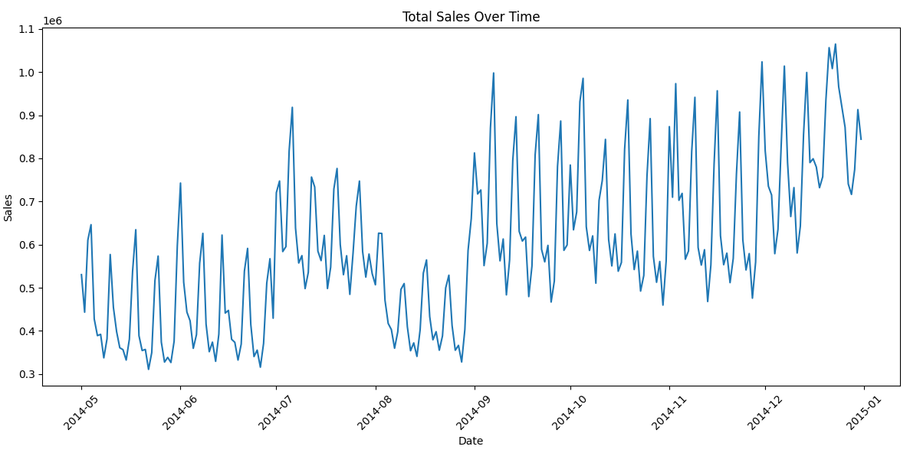
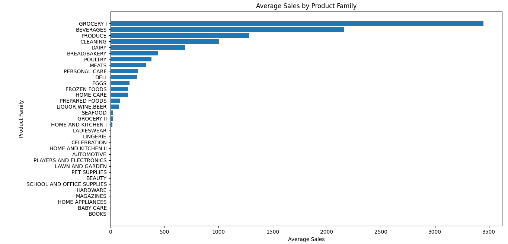
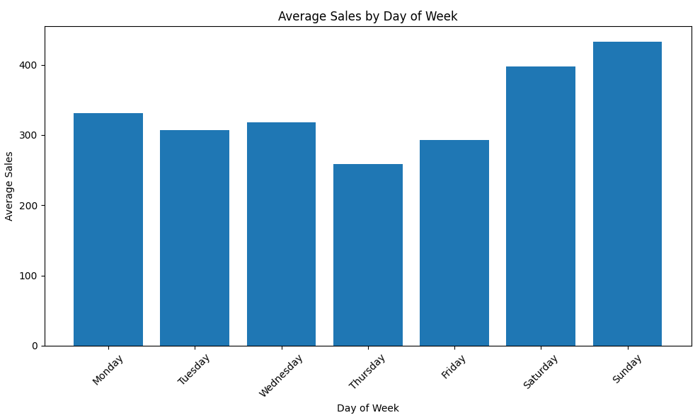
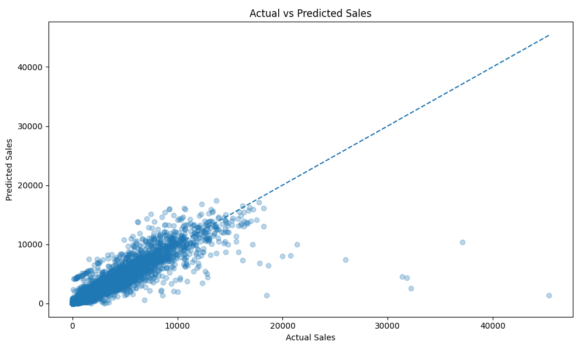
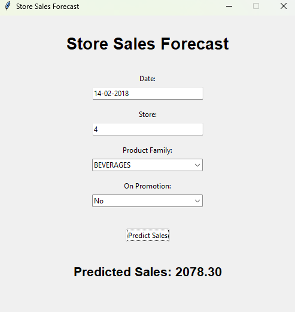

# Store Sales Forecasting using Machine Learning

## Overview

This project uses Machine Learning to forecast product sales for different stores and product families.

The project was developed using Python and Scikit-learn, with a Gradient Boosting Regressor trained on historical sales data. It includes exploratory data analysis, feature engineering, chronological train-test splitting, model evaluation, and an interactive graphical interface for generating sales predictions.

The main goal is to demonstrate an end-to-end Machine Learning workflow applied to a real-world time-series forecasting problem.

## Features

* Historical sales data analysis
* Exploratory Data Analysis (EDA)
* Time-based feature engineering
* Lag and rolling average features
* Chronological train-test split
* Gradient Boosting regression model
* Model evaluation using MAE, RMSE, and R²
* Saved model using Joblib
* Future-date sales prediction
* Interactive GUI built with Tkinter

## Dataset

This project uses the **Store Sales - Time Series Forecasting** dataset from Kaggle, provided by Corporación Favorita.

The original dataset contains historical sales information from stores in Ecuador.

Relevant columns include:

| Column        | Description                      |
| ------------- | -------------------------------- |
| `date`        | Date of the recorded transaction |
| `store_nbr`   | Store identification number      |
| `family`      | Product family                   |
| `sales`       | Number of products sold          |
| `onpromotion` | Number of products on promotion  |

### Dataset Scope

The original dataset contains millions of records. To make the project more manageable, a continuous period was selected:

* **Start date:** April 1, 2014
* **End date:** December 31, 2014
* **Number of records:** Approximately 490,000

This reduced dataset was used to develop and evaluate the forecasting pipeline.

## Exploratory Data Analysis

Several analyses were performed to better understand sales patterns, including:

* Total sales over time
* Average sales by day of the week
* Average sales by product family
* Average sales by store
* Sales with and without promotions
* Total sales by month

These analyses helped identify differences in sales volume between stores, product categories, and time periods.

### Sales Over Time



*Total sales aggregated by date.*

### Average Sales by Product Family



*Comparison of average sales across product families.*

### Average Sales by Day of the Week



*Average sales for each day of the week.*

## Feature Engineering

Feature engineering was used to extract useful information from the date and historical sales data.

### Time-Based Features

The following features were created from the `date` column:

* Day of the week
* Day of the month
* Month
* Year
* Week of the year
* Weekend indicator

### Lag Features

Lag features represent previous sales observations for the same store and product family.

The project uses:

* `lag_1`
* `lag_7`
* `lag_14`
* `lag_30`

These features help the model use historical sales information when generating predictions.

### Rolling Features

Rolling averages were also created:

* `rolling_mean_7`
* `rolling_mean_30`

These features represent average historical sales over seven and thirty observations, respectively.

The rolling calculations use previous observations to avoid directly using the target value of the prediction row.

## Data Preprocessing

The preprocessing pipeline includes:

1. Converting categorical product-family values into numerical features using one-hot encoding.
2. Removing columns that are not used as model inputs, such as `date`.
3. Separating the input features from the target variable.
4. Aligning prediction columns with the columns used during model training.

Rows with missing lag or rolling features are removed before training and evaluation.

## Train-Test Split

Because this is a time-series forecasting project, the data is split chronologically instead of randomly.

The model is trained using earlier dates and evaluated using later dates.

### Training Data

* **Period:** May 1, 2014 – November 11, 2014
* **Records:** 347,490

### Testing Data

* **Period:** November 12, 2014 – December 31, 2014
* **Records:** 87,318

This approach helps evaluate the model using a later period that was not used during training.

## Machine Learning Model

The model used in this project is:

### Gradient Boosting Regressor

The `GradientBoostingRegressor` from Scikit-learn was selected because the target variable, sales, is continuous.

The model combines multiple decision trees sequentially, with each new tree helping improve the predictions made by the previous trees.

### Model Configuration

```python
GradientBoostingRegressor(
    n_estimators=300,
    learning_rate=0.05,
    max_depth=5,
    random_state=42
)
```

The model was trained using the engineered historical sales features.

## Model Evaluation

The model was evaluated using three regression metrics:

| Metric | Result |
| ------ | -----: |
| MAE    |  78.65 |
| RMSE   | 418.39 |
| R²     |   0.89 |

### Metric Explanation

* **MAE (Mean Absolute Error):** Measures the average absolute difference between actual and predicted sales.
* **RMSE (Root Mean Squared Error):** Penalizes larger prediction errors more heavily.
* **R² (Coefficient of Determination):** Measures how well the model explains the variation in the target variable.

The model achieved an R² of approximately 0.89 on the test set. However, the prediction plot shows that the model tends to underestimate some very large sales values.

### Actual vs. Predicted Sales



*Comparison between actual sales and model predictions.*

## Prediction System

The trained model is saved using Joblib:

```text
models/
├── gradient_boosting_model.pkl
└── model_columns.pkl
```

The prediction system loads the saved model and the training feature-column structure.

It then prepares a prediction row containing:

* Date
* Store number
* Product family
* Promotion status
* Time-based features
* Historical lag features
* Rolling average features

The prediction data is aligned with the training columns before being passed to the model.

### Future-Date Prediction

The project supports generating a prediction for a future date using historical observations.

For example:

```text
Date: 2015-01-01
Store: 45
Product Family: BEVERAGES
On Promotion: Yes

Predicted Sales: 11,124.53
```

This example demonstrates a one-day-ahead prediction using historical data available through December 31, 2014.

## Graphical User Interface

The project includes an interactive graphical interface developed with Tkinter.

The GUI allows the user to enter or select:

* Forecast date
* Store number
* Product family
* Promotion status

After submitting the information, the application displays the estimated sales value.

### GUI Preview



*Interactive interface for generating sales predictions.*

## Project Structure

```text
store_sales_forecasting_model/
│
├── data/
│   ├── raw/
│   │   └── train.csv
│   └── processed/
│
├── models/
│   ├── gradient_boosting_model.pkl
│   └── model_columns.pkl
│
├── outputs/
│   ├── plots/
│   ├── predictions/
│   └── metrics/
│
├── src/
│   ├── load_data.py
│   ├── eda.py
│   ├── preprocess.py
│   ├── feature_engineering.py
│   ├── train_test_split.py
│   ├── train.py
│   ├── evaluate.py
│   ├── predict.py
│   ├── gui.py
│   └── main.py
│
├── requirements.txt
├── README.md
└── .gitignore
```

## Technologies and Libraries

* Python
* Pandas
* NumPy
* Scikit-learn
* Matplotlib
* Joblib
* Tkinter

## Installation

### 1. Clone the Repository

```bash
git clone https://github.com/NicolasTorquato/store_sales_forecasting_model.git
```

Navigate to the project directory:

```bash
cd store_sales_forecasting_model
```

### 2. Create a Virtual Environment

```bash
python -m venv .venv
```

Activate the virtual environment on Windows:

```bash
.venv\Scripts\activate
```

### 3. Install Dependencies

```bash
pip install -r requirements.txt
```

### 4. Download the Dataset

Download the `train.csv` file from the Kaggle dataset:

[Store Sales - Time Series Forecasting](https://www.kaggle.com/competitions/store-sales-time-series-forecasting/data)

Place the file inside:

```text
├── data/
│   └── raw/
│       └── ← train.csv goes here after downloading
```

## How to Run

### Run the Complete Machine Learning Pipeline

```bash
python src/main.py
```

This runs the data preparation, feature engineering, training, and evaluation workflow according to the implementation in `main.py`.

> **Note:** The training process can take several minutes depending on the computer's hardware.

### Run the Prediction Script

```bash
python src/predict.py
```

### Run the Graphical Interface

```bash
python src/gui.py
```

The GUI uses the saved model to generate sales predictions.

## Limitations

This project has several limitations:

* The model was trained using a restricted period of historical data from 2014.
* The dataset was reduced to make development and experimentation more manageable.
* The model may underestimate very high sales values.
* Predictions for dates beyond the training period should be interpreted as estimates.
* Future forecasting depends on the availability and quality of historical features.
* Predictions for multiple future dates would require recursive forecasting and assumptions about future promotion values.
* The model has not been deployed as a production system.

These limitations are important when interpreting the model's predictions outside the original training and testing conditions.

## Future Improvements

Possible improvements include:

* Training with a larger historical period
* Hyperparameter optimization
* Comparing additional regression models
* Improving the handling of missing dates
* Implementing multi-day recursive forecasting
* Supporting future promotion schedules
* Improving the graphical interface
* Adding prediction history
* Deploying the application as a web application
* Adding automated model monitoring

## Conclusion

This project demonstrates how Machine Learning can be applied to a sales forecasting problem.

It combines data analysis, feature engineering, time-aware validation, regression modeling, and an interactive prediction interface into a single project.

The project also highlights the challenges of forecasting future values using historical data, particularly when sales patterns and future information are uncertain.